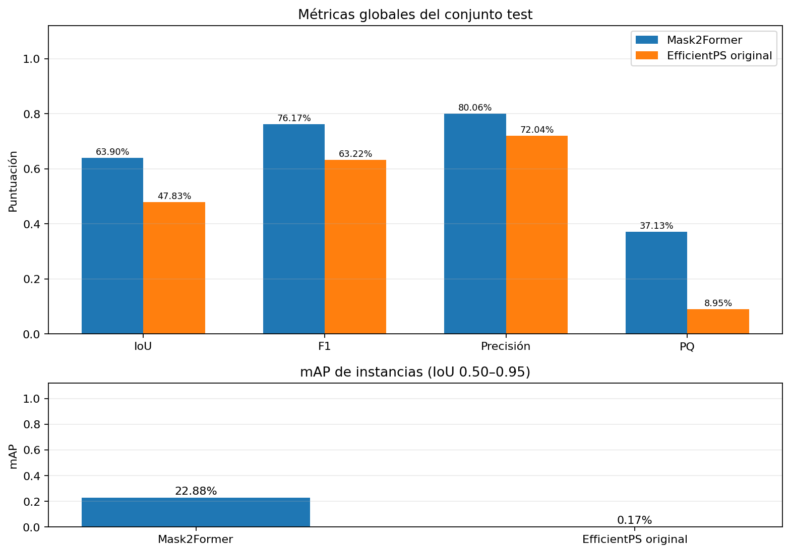
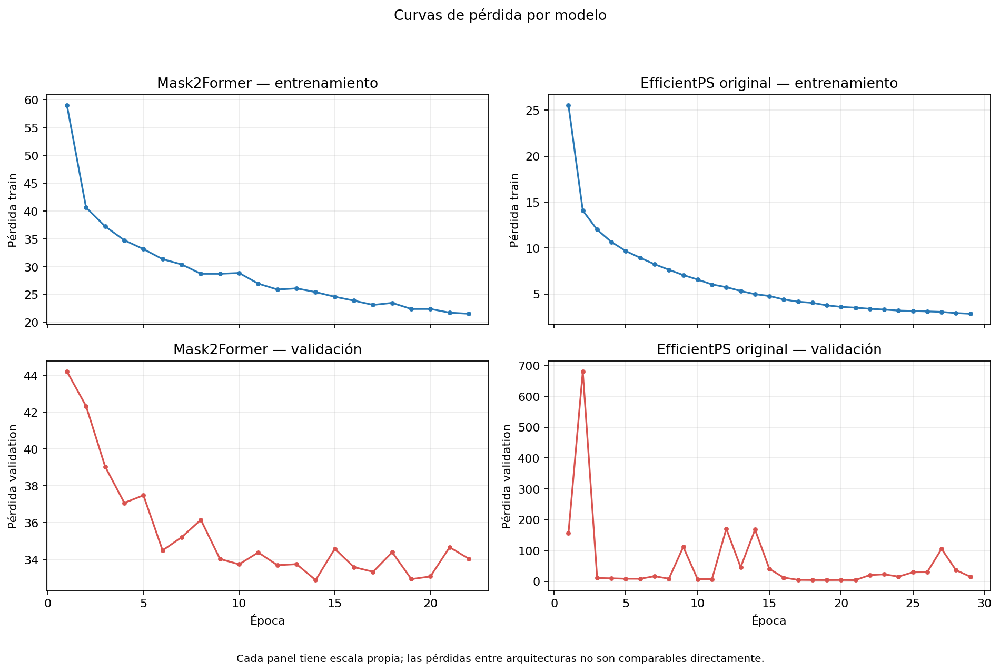
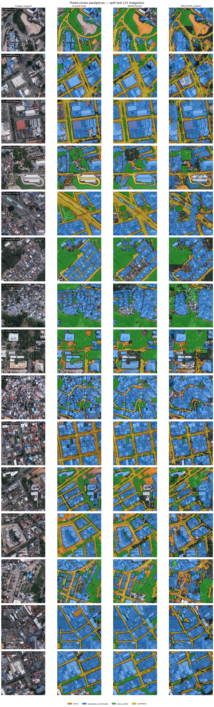

# Comparación de Mask2Former y EfficientPS original

Evaluación sobre **15 imágenes del split test**. IoU, F1 y precisión son promedios macro por píxel; mAP es AP de máscaras thing en IoU 0.50:0.95; PQ es calidad panóptica. Los valores se expresan como porcentaje. `N/D` indica que no se pudo calcular.

## Métricas globales

| Modelo | IoU | mAP | F1 | Precisión | PQ | Ventajas observadas | Limitaciones |
| --- | --- | --- | --- | --- | --- | --- | --- |
| Mask2Former | 63.90% | 22.88% | 76.17% | 80.06% | 37.13% | Mejor resultado de esta comparación en IoU, F1, precisión, mAP y PQ. | El ajuste parte de pesos COCO y solo 100 recortes; el backbone Swin y el decodificador exigen más VRAM que el modelo compacto. |
| EfficientPS original | 47.83% | 0.17% | 63.22% | 72.04% | 8.95% | Implementación oficial con ramas de instancias y semántica y fusión panóptica del método. | Stack legado adaptado y experimental; en estos resultados la detección de instancias queda muy por debajo de Mask2Former. |

## Métricas por clase

IoU, F1 y precisión por píxel; se excluyen los píxeles void.

| Categoría | Mask2Former IoU | Mask2Former F1 | Mask2Former Precisión | EfficientPS original IoU | EfficientPS original F1 | EfficientPS original Precisión |
| --- | --- | --- | --- | --- | --- | --- |
| acera | 32.79% | 49.39% | 58.71% | 26.27% | 41.61% | 46.00% |
| manzana_construida | 82.96% | 90.68% | 93.10% | 67.67% | 80.72% | 82.11% |
| zona_verde | 70.76% | 82.88% | 86.30% | 42.69% | 59.83% | 80.70% |
| carretera | 69.10% | 81.73% | 82.12% | 54.71% | 70.73% | 79.34% |

## Comparación de métricas

## Pérdidas de entrenamiento y validación

Entrenamiento y validación tienen paneles independientes para que los picos de una curva no oculten la otra; las pérdidas entre arquitecturas no son directamente comparables.

## Predicciones frente al ground truth

La hoja muestra, para cada imagen, imagen original, ground truth y predicciones de ambos modelos. Los colores identifican clases; los bordes oscuros separan segmentos.

Se guardaron también comparaciones por imagen en `predictions/both/image_*_comparison.png`.

## Interpretación

Mask2Former presenta mejores métricas globales en esta ejecución, incluida la detección de instancias (mAP). EfficientPS original mantiene valor como comparación de la implementación oficial, pero sus resultados dependen del port experimental para Ubuntu/GPU y de una configuración reducida para la memoria disponible. La escala de pérdida no debe usarse para decidir qué modelo es mejor.
